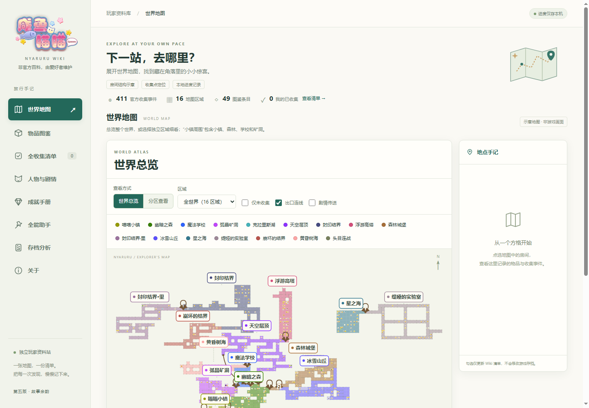
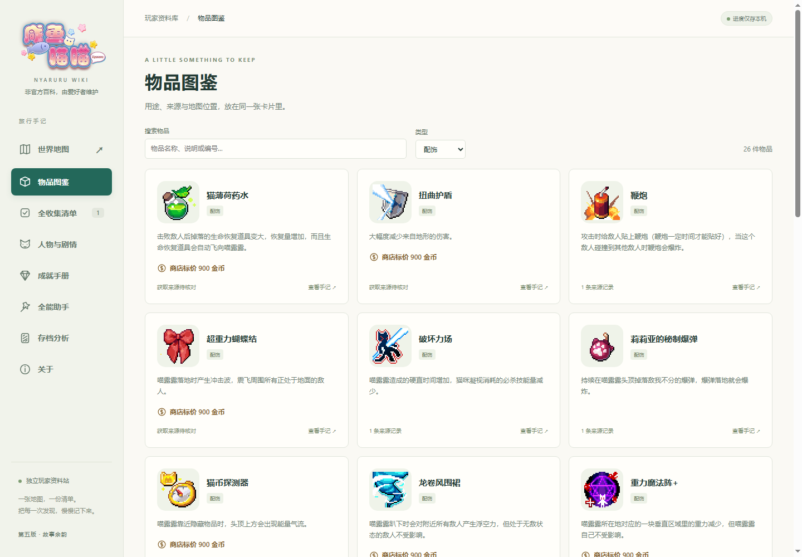

# 咸鱼喵喵 Wiki

一个由爱好者维护的非官方《咸鱼喵喵》资料站。查地图、找物品、记录收集进度，也可以看看人物档案、结局和成就。当前版本为 **0.5.0**。

[作者博客](https://www.serversalem.top/) · [全能助手 / 修改器](https://github.com/Four-way-Xeon/Nyaruru_modifier) · [开发记录](https://www.serversalem.top/index.php/2026/10/03/the_best_nyaruru_modifiersnipping_tool/)

本仓库提供静态网页文件与源码，**未启用 GitHub Pages**。博客上的正式 Wiki 尚待上线，目前可以下载后在本地使用。

**可以查看什么**

- **全收集地图**：996 个地图格、16 个区域、411 个官方收集事件。支持世界总览、分区查看、缩放拖动、出口连线与收集点定位。
- **物品图鉴**：49 项物品，其中有 26 项配饰；使用原版图标，展示说明、已核实的来源和基础商店标价。
- **人物与剧情**：16 位人物、5 个结局。身份揭秘与结局详情默认折叠，主动展开后再阅读。
- **成就手册**：32 项成就。12 项官方隐藏成就和 5 项结局内容逐卡折叠，可读取本地记录核对成就状态。
- **本地存档分析**：查看可识别的位置、金币、背包与已确认收集点，再由你决定是否合并到网页清单。
- **全能助手推荐**：介绍配套工具，提供界面截图、项目入口与开发记录。





**下载后怎么打开**

在 GitHub 点击 **Code → Download ZIP**，解压整个压缩包，然后双击仓库目录里的 **先看Wiki.html**。请保留 `dist` 文件夹及其内部文件。

也可以在你准备存放项目的目录中打开 PowerShell，使用 Git 下载：

```powershell
git clone https://github.com/Four-way-Xeon/nyaruru-wiki.git
```

下载完成后，进入 `nyaruru-wiki` 文件夹，双击 **先看Wiki.html** 即可。

如果浏览器限制本地文件的存储功能，可以安装或使用已有的 **Node.js 22 及以上版本**，双击 **本地预览.bat**，再打开窗口显示的 `http://127.0.0.1:8789/`。也可以在仓库目录中运行：

```powershell
node scripts/preview-server.js
```

这是本机预览地址。关闭预览窗口即可停止服务；直接打开网页和启动本地预览都不需要执行 `npm install`。

**进度与存档**

收集清单保存在当前浏览器的 `localStorage`（浏览器本地存储），不会自动跟随游戏或账号同步。换浏览器、换设备或清理站点数据前，可以先导出清单，再在新环境中导入。

选择存档后，文件只在浏览器中读取、解析，不上传、不改写。已确认完成的收集点需要主动点击合并，才会加入原有清单。

普通 `.rmmzsave` 进度存档不能确认 Steam 账号成就。需要核对时，请在成就手册选择原名为 `UserGameStats_数字_1478160.bin` 的 Steam 本地成就缓存；不要改名，缓存也可能落后于账号在线状态。非 Steam 版可以明确选择对应的 `config.rmmzsave`。只有确认未获得的成就才变灰，未知状态保留为未能确认。成就状态与账号信息不持久保存。

具体操作与范围见 [先读我](先读我.txt)、[存档解析说明](存档解析说明.txt) 和 [成就解析说明](成就解析说明.txt)。维护资料见 [数据约定](DATA-CONTRACT.md)，版本检查结果见 [验收记录](验收记录.txt)。

维护者可在仓库目录运行 `node scripts/check-project.js`，检查随仓库提供的数据和解析程序。`node scripts/qa-browser.js` 使用独立的无界面 Microsoft Edge 检查交互，需要本机安装 Edge；也可通过环境变量 `WIKI_EDGE_PATH` 指定浏览器。两项检查都不需要真实存档。资料导出脚本及带 `--source` 的原文核对另需维护者持有对应原始资料。

**来源与许可**

人物与结局的摘编文字来自萌娘百科及其贡献者，按标注的 **CC BY-NC-SA 4.0** 保留来源与改写说明。该文字许可不覆盖游戏图标、立绘、Logo 或截图中的游戏素材；这些图像的权利归相应权利人。代码与各类素材的许可范围请见 [资料来源与许可](资料来源与许可.txt)。
